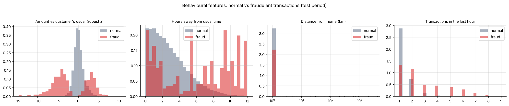
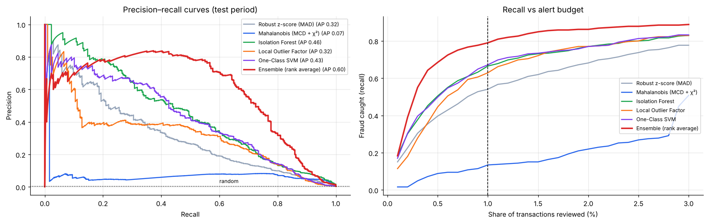
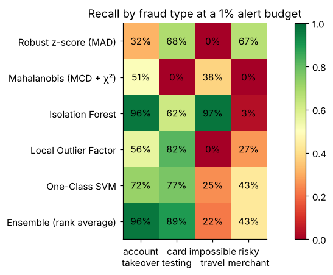
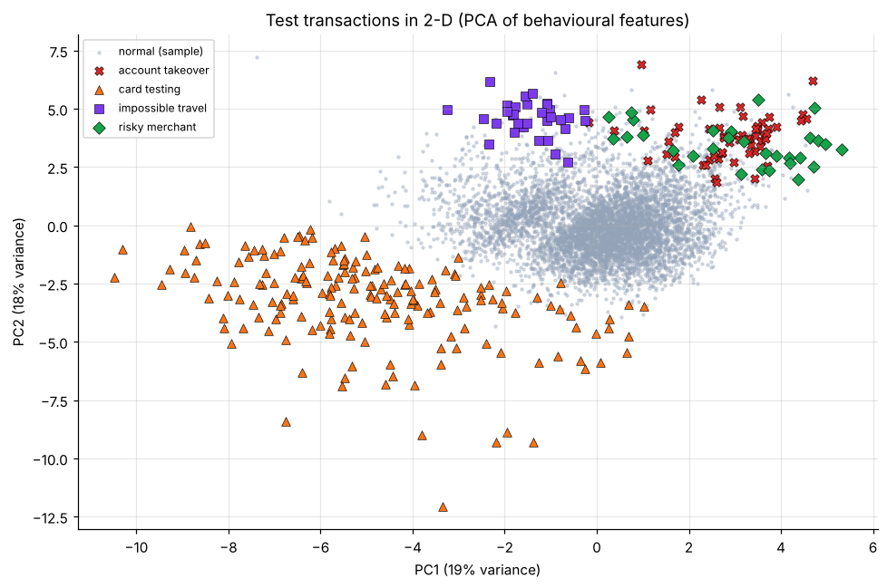

# 🏦 Bank Transaction Anomaly Detection — Statistical vs Machine-Learning Detectors


**Unsupervised** detection of suspicious card transactions: finding fraud *without* fraud labels, the way a bank's monitoring team must when new attack patterns appear. The project compares classical statistical tests with machine-learning detectors, and evaluates them the way an operations team works: **how much fraud is caught when only the top 0.5–1% of transactions can be reviewed**.

> Author: **Priyadharshini Sivasankar** · MSc Data Science · [Portfolio](https://priyadharshini2002-source.github.io/priyadharshini-data-science-portfolio/)

---

## 🗂️ Data — a documented transaction simulator
Real bank transaction data is confidential, so the notebook builds a **reproducible simulated stream**: **143,420 transactions** from 1,000 customers over 60 days, across 12 cities and 10 merchant categories. Each customer has a home city, spending segment, activity level, active hours and category mix. Normal behaviour deliberately includes **legitimate surprises** (big purchases, trips, late nights) so that "large = fraud" doesn't work.

Four fraud patterns are injected (**649 transactions, 0.45%**):

| Pattern | Signature |
|---|---|
| Account takeover | 4–15× usual amount, 00:00–05:00, unfamiliar city |
| Card testing | burst of 4–8 tiny online payments within minutes |
| Impossible travel | transaction in a far city minutes after one at home |
| Risky-merchant spike | large first-ever gambling/crypto payment |

The full dataset is saved to `data/simulated_transactions.csv.gz`.

## ⚙️ Method
- **Leak-free time split.** Each customer's baseline is learned from **days 1–30**, which are unlabelled and already contain some fraud, as they would in reality. Detectors then score **days 31–60**. Labels are used **only for evaluation**.
- **10 customer-relative behavioural features:** robust z-score of amount vs the customer's own median/MAD, cyclical hour, hours away from usual time, distance from home (haversine), category rarity for this customer, minutes since the previous transaction, travel speed (km/h), and transactions in the last hour.
- **Six detectors**

| Detector | Type | Library |
|---|---|---|
| Robust z-score (MAD) | univariate statistical | SciPy |
| Mahalanobis distance + χ² test (robust MCD covariance) | multivariate statistical | scikit-learn + SciPy |
| Isolation Forest | tree-based ML | scikit-learn |
| Local Outlier Factor | density-based ML | scikit-learn |
| One-Class SVM (RBF) | boundary-based ML | scikit-learn |
| Ensemble (rank average of the 4 multivariate detectors) | ensemble | NumPy / SciPy |

## 🏆 Results (test period: 71,612 transactions, 305 fraudulent)

| Detector | ROC-AUC | PR-AUC | Precision @ top 0.5% | Recall @ top 0.5% | Precision @ top 1% | Recall @ top 1% |
|---|---|---|---|---|---|---|
| **Ensemble (rank average)** | **0.986** | **0.596** | **0.584** | **0.685** | **0.337** | **0.790** |
| Isolation Forest | 0.985 | 0.458 | 0.430 | 0.505 | 0.284 | 0.666 |
| One-Class SVM | 0.964 | 0.427 | 0.425 | 0.498 | 0.286 | 0.672 |
| Local Outlier Factor | 0.959 | 0.324 | 0.380 | 0.446 | 0.268 | 0.630 |
| Robust z-score (MAD) | 0.973 | 0.323 | 0.338 | 0.397 | 0.230 | 0.541 |
| Mahalanobis (MCD + χ²) | 0.964 | 0.072 | 0.075 | 0.089 | 0.057 | 0.134 |

*Random baseline PR-AUC = 0.004*

**Recall by fraud type at a 1% alert budget**

| Detector | Account takeover | Card testing | Impossible travel | Risky merchant |
|---|---|---|---|---|
| Robust z-score (MAD) | 32% | 68% | 0% | 67% |
| Mahalanobis (MCD + χ²) | 51% | 0% | 38% | 0% |
| Isolation Forest | **97%** | 62% | **97%** | 3% |
| Local Outlier Factor | 56% | 82% | 0% | 27% |
| One-Class SVM | 72% | 77% | 25% | 43% |
| Ensemble | **97%** | **89%** | 22% | 43% |

### Key findings
- 🏆 **The ensemble wins, and the win is real.** PR-AUC is 0.60 against 0.46 for Isolation Forest, and a paired bootstrap 95% CI of the difference, [+0.08, +0.19], excludes 0. Reviewing just **1% of transactions catches 79% of fraud**, with about 1 in 3 alerts genuine.
- 🧩 **Detectors are complementary.** Isolation Forest is excellent on account takeover and impossible travel but almost blind to risky-merchant spikes. LOF and One-Class SVM are strongest on card-testing bursts.
- 📐 **Check assumptions before trusting p-values.** 6% of transactions get Mahalanobis χ² p < 0.001, where about 0.1% would be expected under normality. The skewed, partly discrete features break the elliptical Gaussian assumption.
- ⚠️ **Averaging can dilute a specialist.** The ensemble catches only 22% of impossible-travel fraud, which Isolation Forest alone catches almost completely. In production, a *max-of-ranks* rule or a dedicated speed rule would close that gap.
- 📊 **ROC-AUC hides the real differences.** Almost every method scores ROC-AUC ≥ 0.96, yet their precision at the alert budget ranges from 6% to 58%.

## 📊 Screenshots

### Behavioural features: normal vs fraud


### Precision–recall curves and recall vs alert budget


### Recall by fraud type


### Anomalies in 2-D (PCA)


The notebook also explains each top alert by listing the features that deviate most (for example, `tx_last_hour +12.7σ, log_km_from_home +6.3σ`), so an analyst can see *why* it was flagged.

## ▶️ How to run
```bash
pip install -r requirements.txt
jupyter notebook Bank_Transaction_Anomaly_Detection.ipynb
```
Everything is generated inside the notebook (fixed random seed), so no download is needed. It runs in about a minute and also works in Google Colab.

## 📁 Structure
```
├── Bank_Transaction_Anomaly_Detection.ipynb   # full analysis with outputs
├── requirements.txt
├── data/simulated_transactions.csv.gz         # generated dataset (143K rows)
├── figures/                                   # plots used above
└── results/                                   # detector comparison, recall by fraud type
```

> ℹ️ Because the data is simulated, the absolute numbers depend on the simulator's assumptions. The value of the project is the **pipeline and the evaluation approach**: customer-relative features, a leak-free time split, budget-based metrics and per-pattern analysis. All of these transfer directly to real transaction data.
